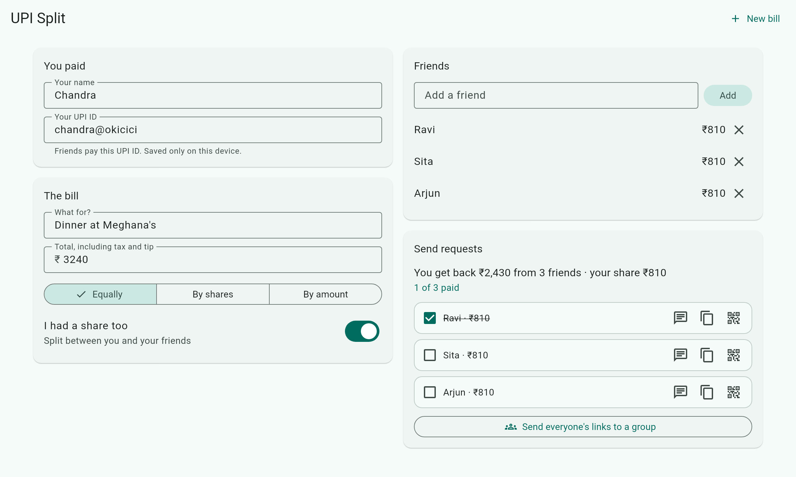
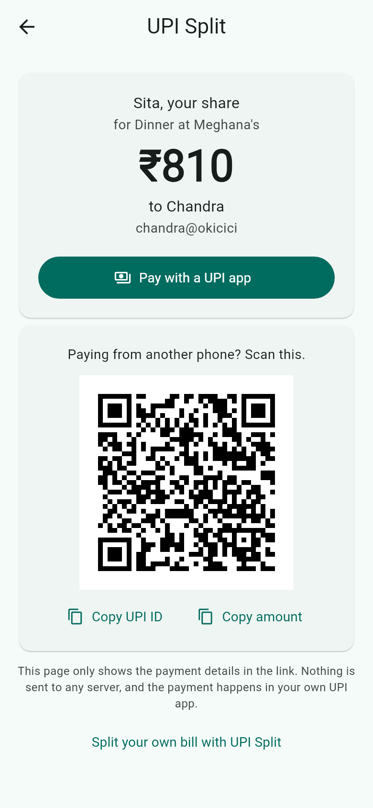

# UPI Split

[](https://github.com/ChandraChaan/upi-split/actions/workflows/ci.yml)
[](https://chandrachaan.github.io/upi-split/)
[](LICENSE)

**Paid for dinner? Split the bill and send every friend their own UPI payment link.** No sign-up, no app to install, and nothing is stored on a server.

<p align="center">
  <a href="https://chandrachaan.github.io/upi-split/"></a>
  
</p>

<p align="center"><b><a href="https://chandrachaan.github.io/upi-split/">Open UPI Split →</a></b></p>

## How it works

1. Enter your name and UPI ID (saved only in your browser).
2. Enter the bill total and add the friends who shared it.
3. Choose how to split: **equally**, **by shares** (a couple counts as 2), or **by amount**. Turn off "I had a share too" if you paid for others only.
4. Send each friend their link on WhatsApp, or show them a QR code across the table.
5. Your friend taps the link, sees exactly what they owe, and pays with **any UPI app**: Google Pay, PhonePe, Paytm, BHIM or their bank's app.
6. Tick friends off as they pay you back.

## Why links, not just a QR code?

WhatsApp and SMS don't make `upi://` links tappable, so a raw UPI link in a chat is just text. UPI Split sends a normal web link instead. It opens a small page with:

- a **Pay with a UPI app** button that opens the payment with the amount filled in (on iPhone, buttons for Google Pay, PhonePe and Paytm, since iOS has no app chooser)
- a **QR code**, for paying from another phone
- **Copy UPI ID** and **Copy amount** buttons, in case their app won't take links

## Privacy

- Your UPI ID, name and bills are stored **only in your browser** (local storage). There's no account and no backend.
- Payment details travel in the link's `#fragment`, which browsers never send to a server, so even the page host can't see who paid whom.
- The payment itself happens entirely in your friend's UPI app. UPI Split never touches money.

## Good to know

- **Rounding is exact.** Amounts are kept in paise, and any odd paise go to friends rather than to you, so the shares always add up to the bill.
- **Some UPI apps limit payment links.** Depending on the app and amount, a payer's app may refuse a pre-filled person-to-person request. The QR code and Copy buttons are there for that case.
- This is a convenience tool, not a payment service. Check the UPI ID before you share links.

## Development

A Flutter app (web and Android) built with Riverpod 3 and [upi_kit](https://github.com/ChandraChaan/upi_kit) for UPI links and validation.

```bash
flutter pub get
flutter test                 # split maths, links, screens, accessibility
flutter run -d chrome
```

| Folder | What's there |
|---|---|
| `lib/split/split.dart` | The split maths: largest-remainder allocation in paise |
| `lib/split/pay_request.dart` | Share links, UPI links and messages |
| `lib/split/split_controller.dart` | State, saved to local storage |
| `lib/ui/` | The split screen and the friend's pay page |

Ideas and bug reports are welcome in [issues](https://github.com/ChandraChaan/upi-split/issues) and [discussions](https://github.com/ChandraChaan/upi-split/discussions).

## License

MIT. See [LICENSE](LICENSE).
