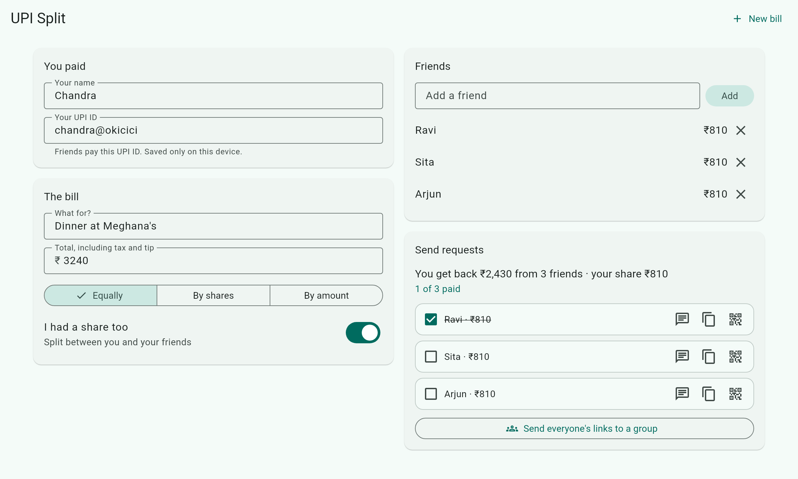
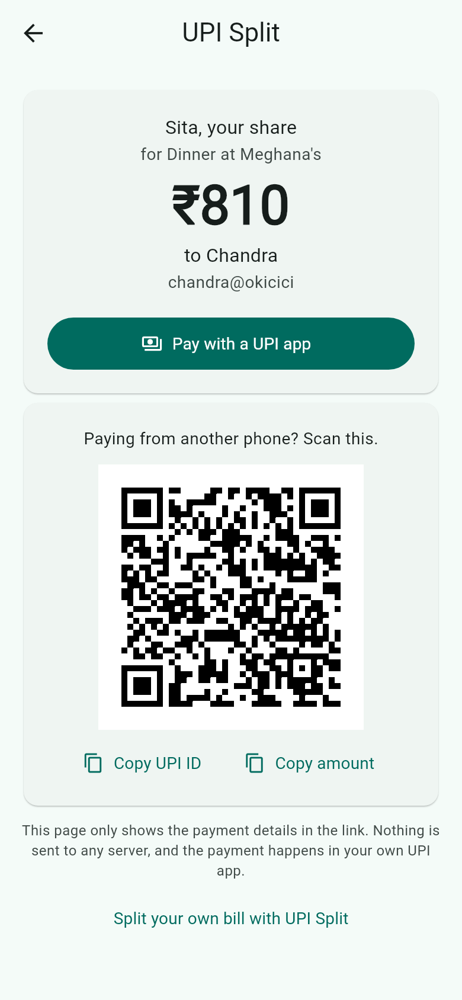

# UPI Split

[](https://github.com/ChandraChaan/upi-split/actions/workflows/ci.yml)
[](https://chandrachaan.github.io/upi-split/)
[](LICENSE)

**Paid for dinner? Split the bill and send every friend their own UPI payment link.** No sign-up, no app to install, and nothing is stored on a server.

<p align="center">
  <a href="https://chandrachaan.github.io/upi-split/"></a>
  
</p>

<p align="center"><b><a href="https://chandrachaan.github.io/upi-split/">Open UPI Split →</a></b></p>

The Android app also includes [Shop](#shop), a store manager for kirana shops. iPhones can use it as a web app.

## How it works

1. Enter your name and UPI ID (saved only on your device).
2. Enter the bill total and add the friends who shared it.
3. Choose how to split: **equally**, **by shares** (a couple counts as 2), or **by amount**. Turn off "I had a share too" if you paid for others only.
4. Send each friend their link on WhatsApp, or show them a QR code across the table.
5. Your friend taps the link, sees exactly what they owe, and pays with **any UPI app**: Google Pay, PhonePe, Paytm, BHIM or their bank's app.
6. Tick friends off as they pay you back.

## Why links, not just a QR code?

WhatsApp and SMS don't make `upi://` links tappable, so a raw UPI link in a chat is just text. UPI Split sends a normal web link instead. It opens a small page with:

- a **Pay with a UPI app** button that opens the payment with the amount filled in (on iPhone, buttons for Google Pay, PhonePe and Paytm, since iOS has no app chooser)
- a **QR code**, for paying from another phone
- **Copy UPI ID** and **Copy amount** buttons, in case their app won't take links

## Privacy

Bill splitting:

- Your UPI ID, name and bills are stored **only on your device**. There's no account and no backend.
- Payment details travel in the link's `#fragment`, which browsers never send to a server, so even the page host can't see who paid whom.
- The payment itself happens entirely in your friend's UPI app. UPI Split never touches money.

Shop is different: it needs an account, and it stores your shop's data, including customers' names, phone numbers and dues, in Firebase. Nothing connects to Firebase unless you open Shop.

## Good to know

- **Rounding is exact.** Amounts are kept in paise, and any odd paise go to friends rather than to you, so the shares always add up to the bill.
- **Some UPI apps limit payment links.** Depending on the app and amount, a payer's app may refuse a pre-filled person-to-person request. The QR code and Copy buttons are there for that case.
- This is a convenience tool, not a payment service. Check the UPI ID before you share links.

## Shop

The **Shop** button in the Android app opens Kirana Mitra (కిరాణా మిత్ర), a store manager for small shops, in Telugu and English. It's currently in internal testing.

- **Sell:** a keypad for the counter, so you don't need a product list. Tap ₹1, ₹2, ₹10 or type any amount (5 × ₹2 works too), then press Cash, UPI or Pay later
- **Pay later:** pick the customer and enter what they paid now. The rest goes on their khata, and anything extra comes off their old dues
- **Khata:** customer credit and payments, outstanding dues, and reminders on WhatsApp or SMS (you press send)
- **Wholesale purchase:** where you bought, the total, what you still owe, the auto fare, and the item list if you have time
- **Today:** sales, cash in the drawer, what you bought, and this month's sales minus purchases and expenses
- **Products and stock (optional):** itemised bills with receipts, inventory and suppliers, for shops that keep a product list
- **Money:** expenses and reports
- **Teams:** multiple stores, with owner, manager and cashier roles. Staff join with an invite code
- **Offline:** keeps working with no internet and syncs when the connection returns

On an iPhone, or any phone without the Android app, open [the Shop web app](https://kirana-mitra-chandra.web.app/shop/) in Safari and tap Share → **Add to Home Screen**. It opens full screen like an app, with the same account and data.

Owners and managers can also use the [web admin](https://kirana-mitra-chandra.web.app) to manage stores, staff and reports. Sign in with the same account.

Shop doesn't calculate GST or scan barcodes with the camera. A plug-in barcode scanner works in the search field.

## Development

A Flutter app. Bill splitting runs on web and Android, built with Riverpod 3 and [upi_kit](https://github.com/ChandraChaan/upi_kit) for UPI links and validation. Shop uses Firebase Auth and Firestore. It runs in the Android app and as its own web app (`apps/shop_web`); the bill-splitting web build leaves it out, so the pay page stays small.

```bash
flutter pub get
flutter test                 # bill splitting and the Shop screens
flutter run -d chrome        # bill splitting
flutter run                  # Android, with Shop
./scripts/test_all.sh        # everything, including Firestore rules (needs Java 21+)
```

| Folder | What's there |
|---|---|
| `lib/split/split.dart` | The split maths: largest-remainder allocation in paise |
| `lib/split/pay_request.dart` | Share links, UPI links and messages |
| `lib/split/split_controller.dart` | State, saved on the device |
| `lib/ui/` | The split screen and the friend's pay page |
| `lib/app_switcher.dart` | Switches between bill splitting and Shop |
| `lib/kirana/` | Shop's Android screens |
| `packages/kirana_core/` | Shop's models, data and offline logic, shared with the web admin |
| `apps/admin/` | The web admin |
| `apps/shop_web/` | Shop as a web app, for iPhones |
| `firestore.rules`, `firebase_tests/` | Shop's security rules and their tests |

### Testing the UPI hand-off on Android

The **Pay with a UPI app** button opens a `upi://pay` link, and real payment apps are hard to test against: you can't make one return a failure, a pending status or a broken response on demand. [FakePay](https://github.com/ChandraChaan/fakepay) is a small open-source Android app that registers for `upi://pay`, moves no money, and answers with the result you pick. Install it on an emulator or test phone and choose it in the app chooser to try the cancelled, failed and pending paths. It also flags requests a strict UPI app would reject.

Running Shop against local emulators, and how to release it, are covered in [docs/KIRANA.md](docs/KIRANA.md). Known limits are in [docs/KIRANA_SECURITY.md](docs/KIRANA_SECURITY.md).

Ideas and bug reports are welcome in [issues](https://github.com/ChandraChaan/upi-split/issues) and [discussions](https://github.com/ChandraChaan/upi-split/discussions).

## License

MIT. See [LICENSE](LICENSE).
